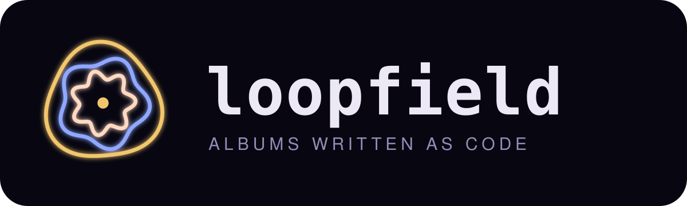
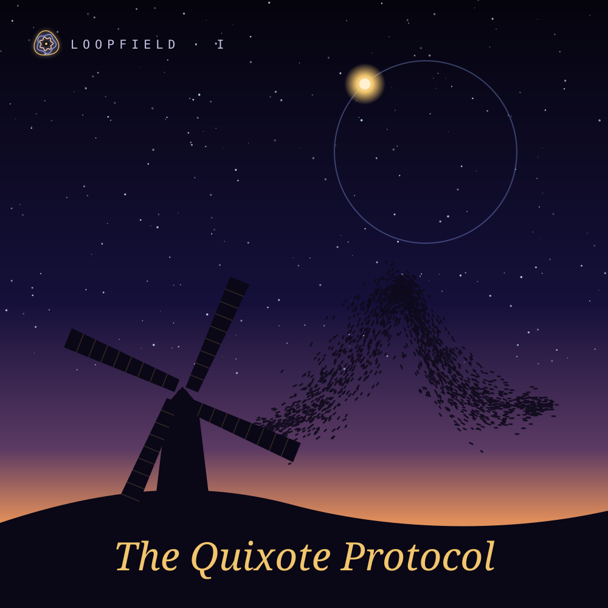
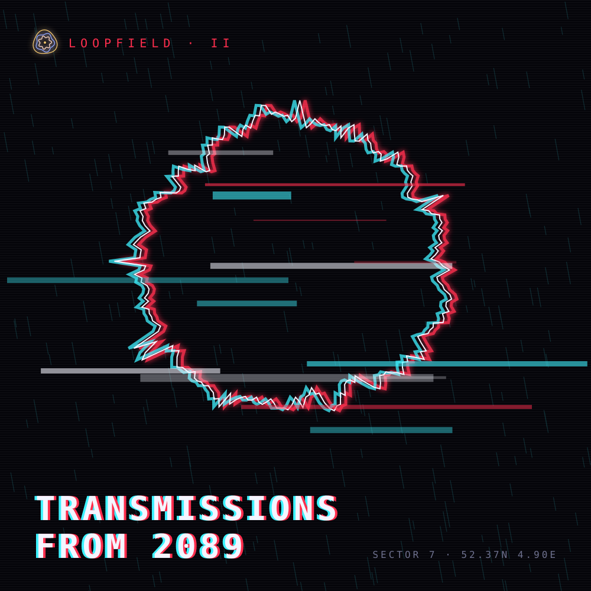
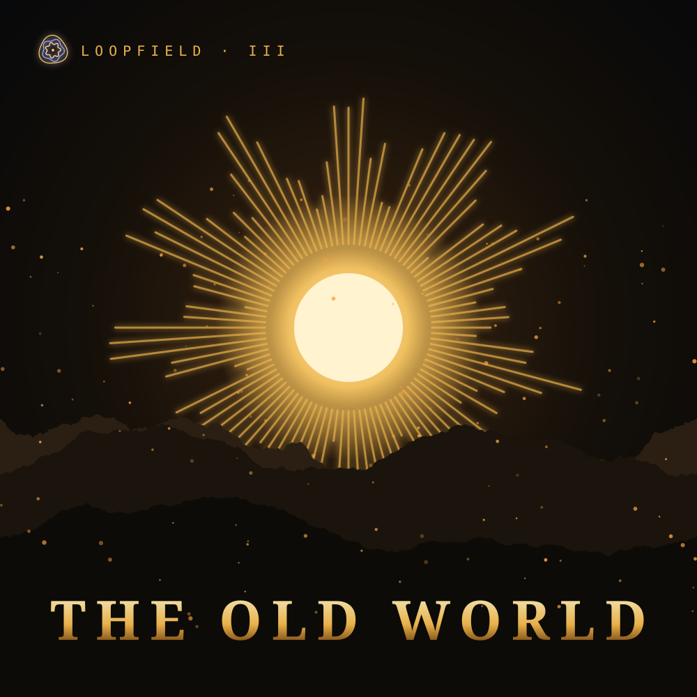
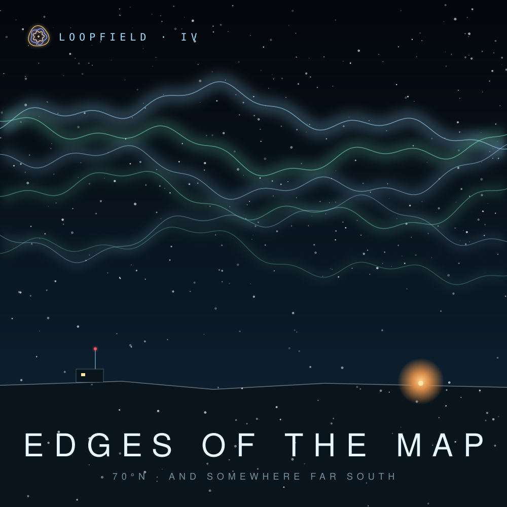

<p align="center"></p>

<p align="center">
  
  
  
  
</p>

Albums of electronic music written as code. Every song is a short program: rhythms, harmonies, voices and noise described as patterns that loop, build and fall away while they play. Pick an album, press play, and rewrite any song while it runs.

**▶ Listen and edit live: [alex-quiterio.github.io/loopfield](https://alex-quiterio.github.io/loopfield/)**

## I · The Quixote Protocol


> *“The most important duty of our lives is to inspire one another.”*

An album in six movements, about 37 minutes. It goes from a rocket's countdown to a piece of land by the sea: machines that dream, voices that agree, a sky full of starlings, giants that are only windmills, and hope as a thing you do. Each track is a full arrangement with intro, builds, breakdowns and an ending, and the player runs straight from one track into the next.

| # | Track | Style | Length | |
| --- | --- | --- | --- | --- |
| 01 | [Poyekhali](songs/poyekhali.strudel) | hazy tape electronica · D major | 6:00 | 108 minutes around the Earth, and the first human to see all of it at once says only: let's go. |
| 02 | [The Factory That Dreams](songs/the-factory-that-dreams.strudel) | melodic techno · A minor | 6:04 | Machines building machines, all night, until one of them closes its eyes and hears a lullaby. |
| 03 | [One Honest Node](songs/one-honest-node.strudel) | meditative drone · D dorian | 6:00 | Many voices, each counting its own cycle. One of them lies. Slowly, the honest ones find each other. |
| 04 | [Murmuration](songs/murmuration.strudel) | dusk folk electronica · E lydian | 6:06 | Ten thousand starlings, each one only watching its nearest neighbours, and the sky turns into one body. |
| 05 | [Tilting at Windmills](songs/tilting-at-windmills.strudel) | devotional hijaz · E phrygian dominant | 6:24 | Everyone else sees windmills. He sees giants, and rides at them anyway, because someone has to believe first. |
| 06 | [Active Hope](songs/active-hope.strudel) | post-rock piano · D major | 6:47 | The road ends at the sea, on a piece of land where something is finally planted. Hope is a thing you do. |

## II · Transmissions from 2089


Four signals recovered from a city that never sleeps: [Curfew](songs/curfew.strudel) (industrial techno), [The Arcology Sleeps](songs/arcology.strudel) (dark ambient), [Surveillance Choir](songs/surveillance-choir.strudel) (darkwave) and [Signal Lost](songs/signal-lost.strudel) (glitch electro).

<br clear="right" />

## III · The Old World


Fire, stone and a long road east: [The Long Road East](songs/the-long-road-east.strudel) (pastoral folk in 6/8), [Halls Under the Mountain](songs/halls-under-the-mountain.strudel) (dark choral) and [The Ember Crown](songs/the-ember-crown.strudel) (epic hybrid).

<br clear="right" />

## IV · Edges of the Map


Ice at one end of the world and drums at the other: [Polar Night Station](songs/polar-night-station.strudel) (arctic ambient) and [Red Earth Gathering](songs/red-earth-gathering.strudel) (tribal percussion).

<br clear="right" />

## How the music is made

The songs are written in [Strudel](https://strudel.cc), the JavaScript port of [TidalCycles](https://tidalcycles.org), a language built for live-coding music. A short song is a `stack` of patterns, one per instrument. An album track names its parts and then arranges them over time:

```js
setcpm(88/4)                                            // 88 bpm, one cycle per bar

const chords = "<[d3,f#3,a3,c#4] [b2,d3,f#3,a3]>/2"     // two bars per chord
const pad  = note(chords).s("gm_pad_warm").attack(1).release(2)
const kick = s("bd ~ ~ ~ ~ ~ bd ~").bank("RolandTR808")

arrange(
  [16, pad],                // 16 bars of pad alone
  [32, stack(pad, kick)],   // then the beat comes in
)
```

A few ideas do most of the work:

- **Mini-notation.** `"bd*4"` is four kicks per bar, `"lt(3,8)"` is a Euclidean rhythm, `"{0 4 7}%8"` is a 3-step cycle over 8 steps and `"<a b>"` alternates bar by bar.
- **Scales, not notes.** Melodies written as scale degrees (`n("0 2 4")`) are mapped by `.scale()`, so a whole song changes mood by swapping one word.
- **Continuous signals.** `sine`, `perlin` and `rand` move filters, volume, panning and even pitch. Poyekhali's whole tape warble is one line, `perlin.range(-.18, .18)`.
- **Arrangement as code.** `arrange()` lays sections end to end; `.mask()` and `.degradeBy()` bring parts in, thin them out or let them fall apart.

## The player

- **Each album has its own world**, with its own palette, typefaces, title effect, button words, background (starlings, rain, embers or snow) and oscilloscope (orbit, ring, sun or aurora). All the visuals react to the audio itself, so they follow your edits too.
- **Albums play through**, with a progress bar and the current bar of the arrangement.
- **Live editing.** Change any line and press <kbd>Ctrl</kbd> + <kbd>Enter</kbd>; <kbd>Ctrl</kbd> + <kbd>.</kbd> stops. **Open in Strudel** sends your edited version to [strudel.cc](https://strudel.cc).
- **Keys.** <kbd>1</kbd>–<kbd>9</kbd> pick a song, <kbd>Space</kbd> plays or stops, arrows step through, <kbd>[</kbd> <kbd>]</kbd> change album, <kbd>R</kbd> picks one at random.

## The art

The logo is three looped rings of 3, 5 and 7 lobes around one centre: cycles that never quite line up, like the voices in *One Honest Node*. Each cover pictures its album's world:

- **The Quixote Protocol:** a windmill at dusk with a starling murmuration and an orbiting sun.
- **Transmissions from 2089:** a broken signal ring in red and cyan.
- **The Old World:** a sun whose rays are a frozen frequency spectrum.
- **Edges of the Map:** aurora over the ice, with a polar station at one end and a fire at the other.

Like the music, the art is code. [`art/make_art.py`](art/make_art.py) draws the logo and every cover as SVG from fixed random seeds, so `python3 art/make_art.py` reproduces them exactly.

## Run it locally

The player fetches the `.strudel` files, so serve the folder rather than opening it as a file:

```sh
python3 -m http.server 8000
# then open http://localhost:8000
```

## Write your own

1. Add `songs/<name>.strudel`. Line 1 is `// TITLE — style · bpm · key`, line 2 is a one-line story, and for an album track line 3 is `// <bars> bars · m:ss`.
2. Add `<name>` to an album in `ALBUMS` at the top of `player.js`.

Sounds available out of the box: the built-in synths (`sine`, `square`, `sawtooth`, `triangle`, `supersaw`, `white`, `pink`, `crackle`), `piano`, the Tidal drum machines via `.bank()` (`RolandTR909`, `RolandTR808`, `LinnDrum` and more), General MIDI instruments (`gm_flute`, `gm_sitar`, `gm_choir_aahs`, `gm_seashore`…), and a few Dirt-Samples sets (`wind`, `metal`, `space`, `numbers`, `crow`, `insect`).

## Credits

Built on [Strudel](https://strudel.cc) by Felix Roos, Alex McLean and contributors (AGPL-3.0), loaded from a CDN at runtime. Instrument and drum sounds come from the Tidal drum machines, General MIDI soundfonts, piano and Dirt-Samples collections that Strudel loads. All compositions are original.
